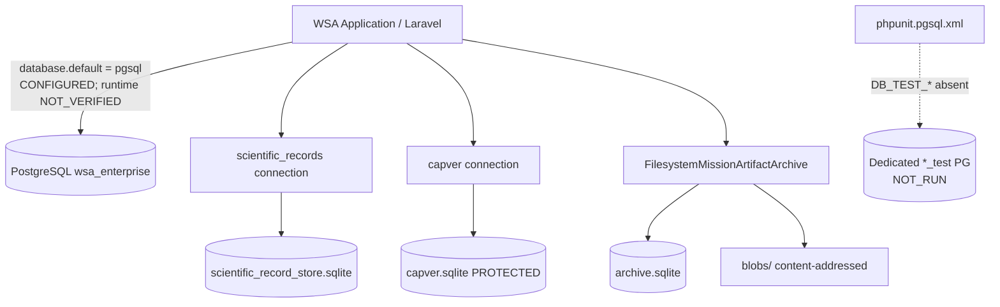

# WSA-Enterprise — Database and Archive Storage Inventory

**Revision:** 10.4  
**Created (UTC):** 2026-11-11T18:20:00Z  
**Baseline HEAD:** `c7b2f771fe7b35bee85acbec032ba37390e6693e`  
**Permission class:** READ_ONLY discovery + DOCUMENTATION (no DB modifications)

## 1. Primary application database

| Field | Value |
|---|---|
| Database ID | `DB-PRIMARY-LARAVEL-DEFAULT` |
| Configured name | `wsa_enterprise` |
| Engine | PostgreSQL (`pgsql`) |
| Role | Intended primary Laravel operational connection |
| Connection name | `config('database.default')` → `pgsql` (this environment) |
| Configuration source | `backend/.env` `DB_CONNECTION` / `DB_*`; `backend/config/database.php` |
| Schema/migrations | `backend/database/migrations/` |
| Repository path | N/A (server database) |
| Runtime path | N/A |
| Runtime verification | **FAILED** — `PDOException SQLSTATE[08006]` password authentication failed to host resolved for `DB_HOST` (message truncated; secrets not recorded) |
| Status | **PARTIAL** — configured identity verified; live connectivity **NOT_VERIFIED** |

**Conclusion:** PostgreSQL `wsa_enterprise` is the **configured** Laravel default connection on this host. It is **not** proven reachable at verification time. Do not conflate this with CapVer, LocalIndex, or Mission Artifact Archive stores.

## 2. Independent SQLite stores (verified files)

| Database ID | Engine | Path | Role | Status |
|---|---|---|---|---|
| `DB-LOCALINDEX-SCIENTIFIC` | SQLite | `backend/storage/app/scientific_record_store.sqlite` | Scientific LocalIndex / scientific_records | FILE_EXISTS; connection `scientific_records` |
| `DB-CAPVER` | SQLite | `backend/storage/app/capver.sqlite` | CapVer capability cell store | FILE_EXISTS; connection `capver` (**PROTECTED**) |
| `DB-MISSION-ARTIFACT-META` | SQLite | `backend/storage/app/mission_artifact_archive/archive.sqlite` | Mission Artifact Archive metadata | FILE_EXISTS; hybrid with blobs |

## 3. Archive artifact filesystem

| Field | Value |
|---|---|
| Component | `FilesystemMissionArtifactArchive` |
| Blob root | `backend/storage/app/mission_artifact_archive/blobs` |
| Disk | Local filesystem (not Laravel `file_disk` abstraction required) |
| Config | `backend/config/mission_artifact_archive.php` |
| Observed blob objects | ~240 entries under blobs/ |
| Metadata count | 705 `mission_artifacts` rows (read-only COUNT) |

## 4. Test-only / ephemeral

| ID | Notes |
|---|---|
| `pgsql_testing` | `phpunit.pgsql.xml` / `DB_TEST_*` — dedicated test connection; **DB_TEST_*** keys not present in `.env` this host |
| `storage/framework/testing/*.sqlite` | Ephemeral PHPUnit files; not operational |

## 5. Docker Compose (deployment identity, not local runtime proof)

`docker-compose.yml` defines service `postgres` image `postgres:16-alpine`, `POSTGRES_DB=wsa_enterprise`, volume `postgres_data`. App services set `DB_HOST: postgres`. This supports the **intended** primary DB identity but does not prove the local Windows process can connect (local probe used resolved host and failed auth).

## 6. Ownership / access boundaries

| Store | Typical readers/writers |
|---|---|
| Laravel default (`pgsql`) | Eloquent models / migrations / general app (when connected) |
| `scientific_records` | LocalIndex ingestion/search (`agricultural_intelligence.local_index.connection`) |
| `capver` | `CapabilityStoreRepository` / CapVer (`capability_store.connection`) |
| Mission archive | `MissionArtifactArchiveFactory` / `mission-artifacts` artisan |

## 7. Architecture diagram (verified relationships only)

Uncertain: live reachability of `PRIMARY` on this host (auth failure). All other solid edges verified from config + file existence + archive readback.

## 8. Explicit non-claims

- No database contents, schemas, paths, or connections were modified in Rev 10.4.
- `database/database.sqlite` is **absent**.
- Successful Mission Artifact Archive readback does **not** prove primary PostgreSQL connectivity.

## 9. Evidence pointers

- `docs/architecture/science-source-expansion/2026-11-11-PHASE-1-PRIMARY-DATABASE-IDENTIFICATION.v10.4.json`
- `docs/architecture/science-source-expansion/2026-11-11-PHASE-1-ARCHIVE-STORAGE-IDENTITY.v10.4.json`
- `docs/architecture/science-source-expansion/_tmp-r104-tests.txt`
