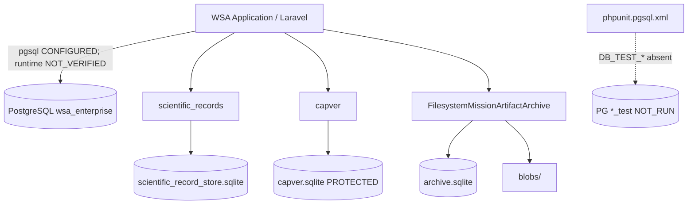

# WSA-Enterprise — تقرير هندسي شامل — المراجعة 10.4

**التاريخ (UTC):** 2026-11-11T18:45:00Z  
**الفرع:** `phase-18-m18-ai-marketing-communications`  
**HEAD:** `c7b2f771fe7b35bee85acbec032ba37390e6693e`  
**المزامنة مع الأصل:** `0/0`  
**التصنيف النهائي:** `PHASE_1_PARTIAL` (مخطط التقدم القانوني: `PHASE_1_GAP_CLOSURE_PARTIAL`)  
**Commit / Push في هذه المراجعة:** **لم يُنفَّذ أي منهما**

---

## A. الملخص التنفيذي

أُنجز اكتشاف قواعد البيانات والأرشفة (قراءة فقط)، وصُنّف CR-R101-02 كـ `IMPLEMENTATION_CONFORMS`، وتحقق تكامل Workstream H جزئياً، وتحقق الأرشيف جزئياً، وأُعدت مصفوفات EXIT-06/08/09/11 دون اختلاق أدلة خارجية.

**المكتمل:** جرد التخزين، هوية الأرشيف الهجينة مع قراءة عكسية وSHA-256 لعينة، مصفوفات الفجوات، اختبارات مركّزة 83/424 EXIT 0.

**المتبقي:** اتصال PostgreSQL التشغيلي غير مُتحقق؛ حزم تحقق العائلات؛ مراجع IC/Cap الحقيقية؛ مجموعة PostgreSQL المعزولة (EXIT-09)؛ أدلة EXIT-05/07 وSupplement 04؛ بوابة EXIT-11؛ أرشفة وثائق 10.4.

---

## B. حالة المستودع

| الحقل | القيمة |
|---|---|
| Branch | `phase-18-m18-ai-marketing-communications` |
| HEAD | `c7b2f77` (Rev 10.1 مُسلَّم) |
| Remote | `origin/...` متزامن `0/0` |
| Working tree | WIP سابق محفوظ (ملفات غير متعلقة بهذه المراجعة لم تُمس) |
| Staged | لا شيء مُضاف لهذه المراجعة |
| Stash | فارغ (حسب التحقق السابق) |
| حماية WIP | لم يُستخدم `reset --hard` / `clean` / `add .` / `restore .` |

---

## C. الحوكمة

- المتطلبات السابقة (§8.24.9 / §8.25.10–11 / §8.26.6–7 / §8.63.10) تبقى سارية مع تطبيق ثنائي مع §8.64.7 (CR-R101-01).
- §8.64.7: `PROPOSED CONSOLIDATED CHECKLIST — NOT OWNER-APPROVED` — لا يلغي المتطلبات الأسبق وحدها.
- CR-R101-01: محفوظ.
- CR-R101-02: محدَّث → **`IMPLEMENTATION_CONFORMS`** (كود CapVerSeat في HEAD يتوافق مع حدود الكتابة؛ نص §8.81.2 تاريخي متأخر وثائقياً).
- Acceptance Baseline: v10.1 مقفول؛ لم يُضعَف.
- الحالة القانونية: `docs/phase-1-progress.json`؛ الأدلة: `docs/evidence-ledger.json` (إضافة `session_addenda` فقط دون قلب حالات PASS).

---

## D. هوية قاعدة البيانات الأساسية

| الحقل | القيمة |
|---|---|
| الاسم | `wsa_enterprise` |
| المحرك | PostgreSQL |
| الاتصال | `database.default` → `pgsql` |
| المسار | خادم (ليس ملفاً) |
| المصدر | `backend/.env` + `config/database.php` + `docker-compose.yml` |
| المخطط | `backend/database/migrations/` |
| التحقق التشغيلي | **فشل المصادقة** — `PRIMARY_DATABASE` مُعرَّف تكويناً؛ الاتصال الحي **`NOT_VERIFIED`** |
| الحالة | **PARTIAL** |

ليست قواعد CapVer / LocalIndex / Archive هي القاعدة الأساسية للتطبيق.

---

## E. جرد قواعد البيانات

| المعرّف | المحرك | المسار / الهوية | الدور |
|---|---|---|---|
| DB-PRIMARY-LARAVEL-DEFAULT | PostgreSQL | `wsa_enterprise` | أساسي مُكوَّن |
| DB-LOCALINDEX-SCIENTIFIC | SQLite | `backend/storage/app/scientific_record_store.sqlite` | LocalIndex |
| DB-CAPVER | SQLite | `backend/storage/app/capver.sqlite` | CapVer (محمي) |
| DB-MISSION-ARTIFACT-META | SQLite | `.../mission_artifact_archive/archive.sqlite` | بيانات وصفية للأرشيف |
| pgsql_testing | PostgreSQL | `DB_TEST_*` / `phpunit.pgsql.xml` | اختبار فقط — غير متوفر محلياً |

---

## F. بنية تخزين الأرشيف

- المكوّن: `FilesystemMissionArtifactArchive`
- البيانات الوصفية: `archive.sqlite` (SQLite)
- المحتوى: نظام ملفات `blobs/{aa}/{bb}/{sha}.bin`
- العدد: 705 أثر؛ ~240 كائن blob
- القراءة/الكتابة: `get` / `ingestFile` عبر الواجهة
- التحقق: تطابق `content_sha256` مع `hash_file`
- العينة: `maa_aef9b37e364e2517_a5442d11c9c5` → **ARCHIVED_AND_VERIFIED**

---

## G. مخطط المعمارية

انظر القسم §7 في  
`docs/architecture/DATABASE-AND-ARCHIVE-STORAGE-INVENTORY.md`

---

## H. CR-R101-02

- نص ADR §8.81.2 يصف حالة تاريخية (WIP غير متتبع / وسيطتان).
- الكود في `cfc9d1b` + DI في `c7b2f77`: متتبع، `persistCurrent` بثلاث وسائط، resolve ناجح.
- **الخلاصة:** `IMPLEMENTATION_CONFORMS` — لا قرار مالك مطلوب لتثبيت العقد؛ يُوصى لاحقاً بملاحظة append-only على ADR.

---

## I. Workstream H

| الحالة | القيمة |
|---|---|
| H_DOCUMENTATION_STATUS | DONE |
| H_INTEGRATION_VERIFICATION_STATUS | PARTIAL |
| H_OVERALL_STATUS | PARTIAL |

| المسار | الحالة |
|---|---|
| H1 CSQ Builder→Compiler | VERIFIED |
| H2 Compiler→Source query | PARTIAL |
| H3 Orchestration→Adapter | PARTIAL |
| H4 Adapter→Normalization | PARTIAL |
| H5 Evidence→CapVer/Projection | VERIFIED |
| H6 LocalIndex | PARTIAL |
| H7 Mission Artifact Archive | VERIFIED |

هوية CSQ عبر السلسلة الكاملة: **PARTIAL**.

---

## J. Workstream I

- جرد: 705 أثر موجود.
- قراءة عكسية + سلامة عينة Rev10.1: **ARCHIVED_AND_VERIFIED**.
- وثائق Rev10.4: **CREATED_NOT_ARCHIVED** (مؤجّل حتى جلسة Commit مصرّح بها).
- **I = PARTIAL**.

---

## K. EXIT-06

مصفوفة على مستوى السجلات: المداخل المحكومة (`gbif`, `agris`, `dr_duke`, `organic_eprints`, `bhl`) → `MISSING_REFERENCE` لمراجع IC/Cap المخزّنة.  
الإرث Stage3 بدون `adr_id`: COMPLETE ضمن نطاقه.  
لم تُختلق مراجع. المعيار يبقى **PARTIAL**.

---

## L. EXIT-08

| العائلة | الاختبارات | حزمة التحقق | الحالة |
|---|---|---|---|
| REST / RestJson | ضمن Family EXIT 0 | MISSING | PARTIAL |
| OAI-PMH | ضمن Family EXIT 0 | MISSING | PARTIAL |
| Bulk / Dataset | ضمن Family EXIT 0 | MISSING | PARTIAL |

العدد التجميعي لا يغني عن حزم العائلة. المعيار **PARTIAL**.

---

## M. EXIT-09

- الاختبار على PostgreSQL **إلزامي** لنطاقات persist/concurrency المعزولة (ليس لإثبات أن PostgreSQL هو محرك CapVer التشغيلي).
- الآلية: `backend/phpunit.pgsql.xml` + `DB_TEST_*` + قاعدة `*_test`.
- التنفيذ: **NOT_RUN** — `DB_TEST_*` غائبة؛ الحاجز `P1-BLK-2026-11-11-EXIT09-PG-01`.
- جزء SQLite لهذه الجلسة: 83 اختباراً / 424 تأكيداً / EXIT 0.

---

## N. EXIT-11

- تعريف: تقرير تحقق يُلحق بـ ADR يعيد التحقق من P1-EXIT-01..10 ثم قرار خروج صريح.
- طبيعة: **بوابة تجميعية** — ليست مستقلة.
- كل الاعتماديات يجب أن تكون PASS.
- الحالة: **NOT_RUN**.

---

## O. EXIT-05 / EXIT-07 / D-08

| المعيار | الحاجز | الحالة |
|---|---|---|
| EXIT-05 | P1-BLK-…-EXIT05-STAGING-01 | BLOCKED — لا أدلة مشغّل جديدة |
| EXIT-07 | P1-BLK-…-G2-26-01 | BLOCKED — لا دليل IC أصلي |
| D-08 | P1-BLK-…-D08-01 | BLOCKED — Supplement 04 غير موجود / تاريخ غير محسوم |

لم يُختلق أي دليل خارجي أو تاريخي.

---

## P. الاختبارات

| الأمر | الدليل | النتيجة |
|---|---|---|
| `phpunit` Family + `ScientificSourceCatalogContractTest` + `CapVerWriteBoundaryTest` | `_tmp-r104-tests.txt` | **83 / 424 / EXIT 0** |
| PostgreSQL Cap suite | — | **NOT_RUN** |
| اتصال PDO تشغيلي `SELECT 1` | probe | فشل مصادقة (بدون تسجيل أسرار) |

دليل العمل: `backend`؛ الإعداد: `phpunit.xml` الافتراضي (SQLite/اختبارات وحدة).

---

## Q. التوثيق والأرشيف

### ملفات أُنشئت/حُدّثت في هذه المراجعة (مقترحة للـ Commit لاحقاً)

1. `docs/architecture/DATABASE-AND-ARCHIVE-STORAGE-INVENTORY.md`
2. `docs/architecture/science-source-expansion/2026-11-11-PHASE-1-PRIMARY-DATABASE-IDENTIFICATION.v10.4.json`
3. `docs/architecture/science-source-expansion/2026-11-11-PHASE-1-ARCHIVE-STORAGE-IDENTITY.v10.4.json`
4. `docs/architecture/science-source-expansion/2026-11-11-PHASE-1-REV10.4-ARCHIVE-VERIFICATION.v10.4.json`
5. `docs/architecture/science-source-expansion/2026-11-11-PHASE-1-CONFLICT-RESOLUTION-CR-R101-02.v10.4.json`
6. `docs/architecture/science-source-expansion/2026-11-11-PHASE-1-EXIT-06-RECORD-GAP-MATRIX.v10.4.json`
7. `docs/architecture/science-source-expansion/2026-11-11-PHASE-1-EXIT-08-FAMILY-VERIFICATION-MATRIX.v10.4.json`
8. `docs/architecture/science-source-expansion/2026-11-11-PHASE-1-EXIT-09-REQUIREMENT-ASSESSMENT.v10.4.json`
9. `docs/architecture/science-source-expansion/2026-11-11-PHASE-1-EXIT-11-AUTHORITY-AND-DEPENDENCY.v10.4.json`
10. `docs/architecture/science-source-expansion/2026-11-11-PHASE-1-REV10.4-INTEGRATION-PATHS-VERIFICATION.v10.4.json`
11. `docs/architecture/science-source-expansion/2026-11-11-PHASE-1-REV10.4-EXTERNAL-BLOCKERS.v10.4.json`
12. `docs/architecture/science-source-expansion/2026-11-11-PHASE-1-REV10.4-MISSION-COMPLETION.v10.4.json`
13. `docs/architecture/science-source-expansion/2026-11-11-PHASE-1-REV10.4-SESSION-REPORT.ar.md`
14. `docs/architecture/science-source-expansion/_tmp-r104-tests.txt`
15. `docs/phase-1-progress.json` (تحديث رأس/ملاحظات/اختبارات — **بدون** تغيير حالات EXIT القانونية)
16. `docs/evidence-ledger.json` (`session_addenda` فقط)

### آثار مؤكدة

- `maa_aef9b37e364e2517_a5442d11c9c5` — ARCHIVED_AND_VERIFIED

---

## R. مراجعة ما قبل الـ Commit

### قائمة الملفات المتغيرة لهذه المراجعة فقط

الملفات الـ 16 أعلاه. **لا تُدرج** ملفات WIP السابقة (مثل تعديلات Feature tests / `.env.example` / أوامر CapVer غير المرتبطة بـ 10.4).

### ملخص الفروقات

- توثيق اكتشاف DB/Archive + مصفوفات EXIT + تصنيف CR + تحقق تكامل/أرشيف + سجل أدلة إضافي + تحديث تقدّم وصفي.

### نتائج الاختبار

`OK (83 tests, 424 assertions)` — EXIT 0.

### المخاطر المتبقية

- عدم اتصال PostgreSQL التشغيلي محلياً.
- EXIT-09 PG غير مُنفَّذ.
- فجوات IC/Cap وحزم العائلات.
- أدلة خارجية محجوبة.
- وثائق 10.4 غير مؤرشفة بعد.

### اقتراح الـ Commits (للجلسة التالية بعد الإذن)

1. `docs(phase-1): Rev 10.4 database/archive discovery and EXIT matrices`
2. اختياري منفصل: أرشفة MAA لوثائق 10.4 بعد الـ Commit

### هدف الـ Push المقترح

`origin/phase-18-m18-ai-marketing-communications` — **بعد إذن صريح فقط**.

### تأكيد السلامة

**لم يُنفَّذ Commit ولا Push في المراجعة 10.4.**  
**لم تُعدَّل أي قاعدة بيانات أو مخطط أو مسار أو بيانات.**

---

## S. القرار النهائي

# `PHASE_1_PARTIAL`

(مكافئ المخطط: `PHASE_1_GAP_CLOSURE_PARTIAL`)

لا يُعلن اكتمال المرحلة 1 بينما EXIT-05/07 محجوبة، وEXIT-06/08/09/10 جزئية، وEXIT-11 غير مُنفَّذة، وD-08 غير محسوم.
