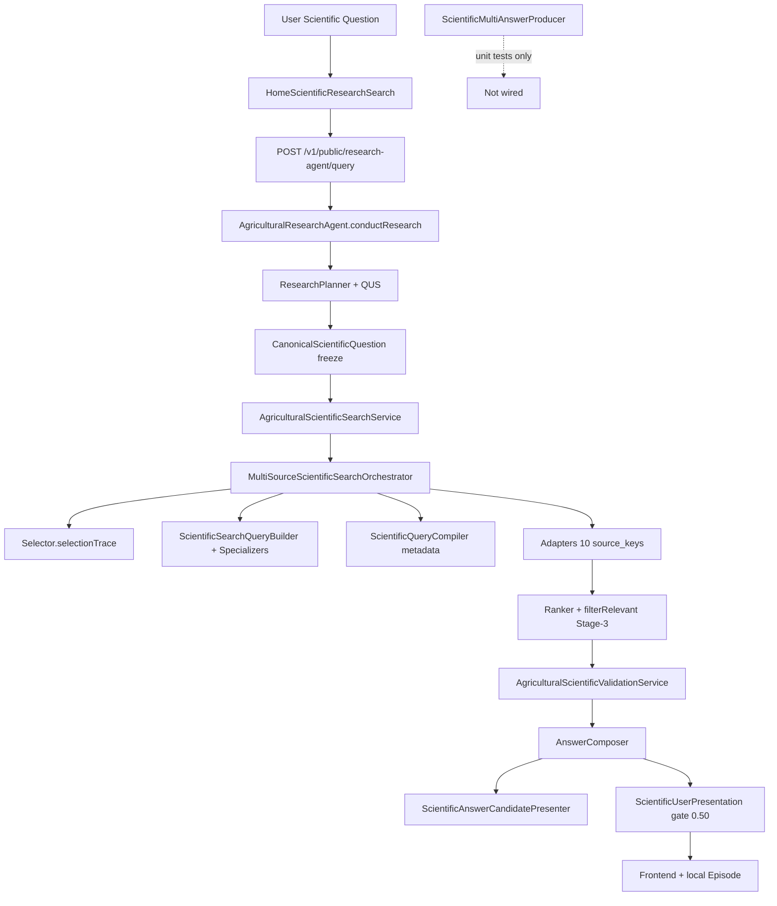
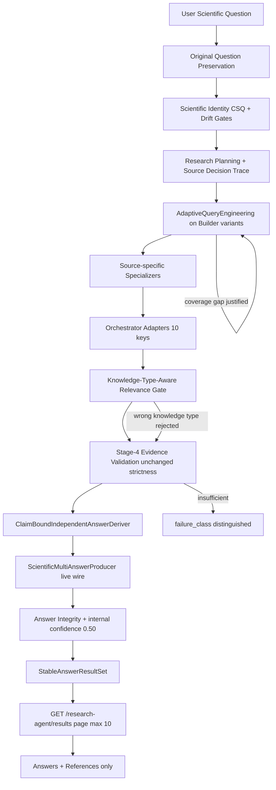

# WSA-Enterprise — Revision 6.1 Implementation Report
## Alternative B — Selective Architectural Redesign
### Baseline: Revision 5.5 + Selective Merge (Revision 5.6)

## A. حالة التنفيذ

تم تنفيذ المسار الانتقائي المعتمد دون إعادة بناء شاملة:

| المجال | الحالة |
|---|---|
| Knowledge-Type-Aware Relevance | منفَّذ عبر توسيع `ScientificEvidenceRelevanceGate` |
| Adaptive Query Engineering | منفَّذ كمساعِد فوق Builder/Orchestrator |
| حماية Early-Stop حسب نوع المعرفة | منفَّذ (لا يتخطى GBIF/BHL/… عند الحاجة) |
| Multi-Answer Producer في المسار الحي | موصول عبر Agent بعد Composer |
| Stable Answer Result Set + Pagination | منفَّذ (تخزين ملفات + `GET /research-agent/results`) |
| Source Contribution Ladder | توسيع observability الحالية |
| تمييز حالات الفشل | `failure_class` / `failure_code` في استجابة Agent |
| جرد المصادر | 10 مصادر Stage-3 موثّقة |

### إعادة استخدام
- Catalog / Selector / Orchestrator / Builder / Compiler / Specializers
- Validation Stage-4 دون تخفيف
- `ScientificMultiAnswerProducer` + العقود الحالية
- `selectionTrace` / `sourceOutcomes`

### مكونات جديدة ضرورية فقط
- `ScientificKnowledgeType` + `ScientificKnowledgeTypeRelevancePolicy`
- `AdaptiveQueryEngineering`
- `ClaimBoundIndependentAnswerDeriver`
- `StableAnswerResultSet` + `StableAnswerResultSetStore`

## B. جرد المصادر

- **عدد Stage-3 runtime قبل/بعد:** 10 (لم يُسقط أي مصدر قائم)
- **المصادر الخمسة الجديدة:** `agris`, `organic_eprints`, `dr_duke`, `gbif`, `bhl` — ضمن الكتالوج والـSelector
- التفاصيل: `2026-11-20-REV6.1-SOURCE-INVENTORY.json`

## C. المعمارية

### المسار النهائي
UI → API query → Agent → QUS/CSQ → Planner → Orchestrator (Query Engineering + Adaptive + Specializers + Adapters) → Ranker/Knowledge-Type Relevance → Validation → Composer → Independent Answer Deriver → MultiAnswerProducer → StableResultSet → Presentation / Pagination

### Current Architecture — Pre-Implementation Baseline

### Target Architecture — Post-Implementation Design

## D. سلامة البحث العلمي
- CSQ يبقى سلطة دلاليّة (ADR-022)؛ التوسع لا يغيّر الهوية
- Compiler يبقى metadata؛ Builder يبقى تنفيذ الاستعلام
- Relevance مرحلة 3؛ Validation مرحلة 4 دون دمج
- Traditional use ≠ clinical efficacy؛ chemical association ≠ therapeutic effectiveness

## E. Multi-Answer and Pagination
- Producer موصول من `AgriculturalResearchAgent::buildMultiAnswerAndStableEnvelope`
- الإجابات المستقلة مشتقة من Claims المربوطة بالأدلة فقط
- Stable set ملفّي مع عزل `organization_id`
- Pagination قراءة شريحة فقط: `rerun_performed=false`, لا Search/Composer/Validation

## F. الاختبارات (مستوى Unit)
| اختبار | النتيجة |
|---|---|
| ScientificKnowledgeTypeRelevancePolicyTest | PASS |
| ClaimBoundIndependentAnswerDeriverTest | PASS |
| StableAnswerResultSetStoreTest | PASS |
| ScientificMultiAnswerProducerTest | PASS |

## G. Git
يُستكمل عند Commit/Push في نهاية الجلسة.

## H. الفجوات المتبقية
- معايرة Precision/Recall الكمية: مؤجّلة (لا بيانات معايرة)
- Contribution analytics متقدمة: مؤجّلة
- UI قد لا تستهلك Stable set بعد — يحتاج ربط واجهة لاحقًا
- Phase 1 يبقى `PHASE_1_GAP_CLOSURE_PARTIAL`

## Traceability (قرارات حرجة)
| قرار | ملف | اختبار |
|---|---|---|
| Knowledge-type relevance | `ScientificEvidenceRelevanceGate.php` | ScientificKnowledgeTypeRelevancePolicyTest |
| Early-stop حماية النوع | `MultiSourceScientificSearchOrchestrator.php` | ScientificKnowledgeTypeRelevancePolicyTest |
| Multi-Answer live | `AgriculturalResearchAgent.php` | ClaimBoundIndependentAnswerDeriverTest |
| Stable pagination | `StableAnswerResultSet*.php`, Controller `pageResults` | StableAnswerResultSetStoreTest |
| Identity none-mode | `MultiAnswerIdentitySerializer.php` | ScientificMultiAnswerProducerTest |
