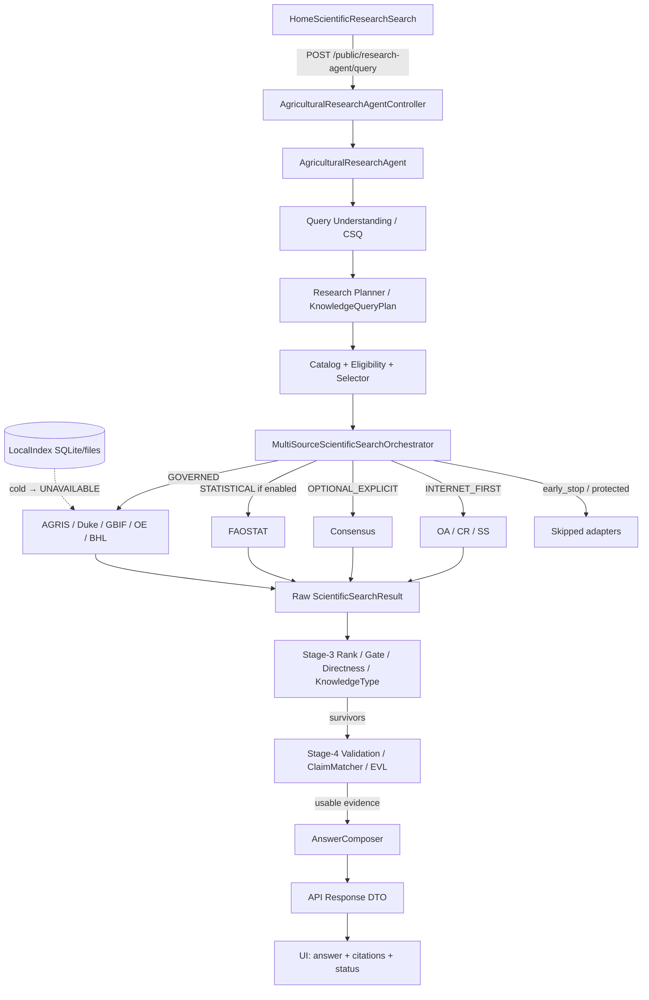
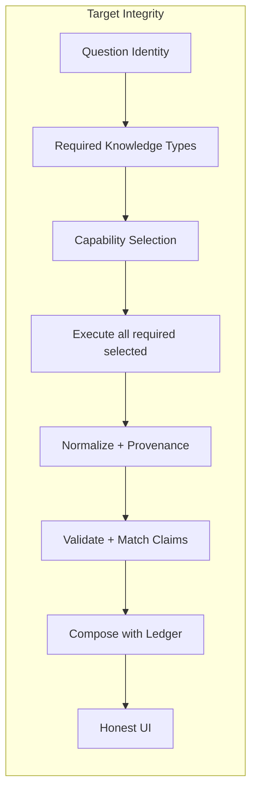

# WSA-Enterprise — Scientific Search End-to-End Root-Cause Audit & Remediation Plan

**Mission ID:** `WSA-SCIENTIFIC-SEARCH-ROOT-CAUSE-AUDIT-AND-REMEDIATION-PLAN`  
**Mode:** READ-ONLY (no application code, config, DB, index, commit, or push)  
**Date:** 2026-11-22  
**Final classification:** `COMPREHENSIVE_AUDIT_AND_REMEDIATION_PLAN_COMPLETE`

**Companion files:**
- [`SCIENTIFIC-SOURCE-INTEGRATION-MATRIX.md`](./SCIENTIFIC-SOURCE-INTEGRATION-MATRIX.md)
- [`SCIENTIFIC-ROOT-CAUSE-REGISTER.md`](./SCIENTIFIC-ROOT-CAUSE-REGISTER.md)
- [`SCIENTIFIC-REMEDIATION-ROADMAP.md`](./SCIENTIFIC-REMEDIATION-ROADMAP.md)
- [`SCIENTIFIC-AUDIT-EVIDENCE-INDEX.md`](./SCIENTIFIC-AUDIT-EVIDENCE-INDEX.md)
- [`00-BASELINE.txt`](./00-BASELINE.txt)
- Live smoke: [`E-AUDIT-01-wheat.json`](./E-AUDIT-01-wheat.json), [`E-AUDIT-02-mentha.json`](./E-AUDIT-02-mentha.json)

---

## 1. Executive Summary

المسار العلمي **متصل من الواجهة إلى الإجابة** عبر `POST /api/v1/public/research-agent/query`، وينتج إجابات علمية مدعومة بالمصادر على أسئلة عامة (قمح) وأسئلة تصنيفية (Mentha) في البيئة الحالية.

**ما يعمل (مثبت):**
- كتالوج الإنتاج لعشرة مفاتيح (`ScientificSourceCatalog` + `PRODUCTION_KEYS`).
- مسار Scholarly الافتراضي: OpenAlex + Crossref + Semantic Scholar → Stage-3/4 → Composer.
- إصلاحات سابقة: هوية `source_key` في Stage-4، توجيه التصنيف التصنيفي، حماية Early-Stop للمصادر المميزة، Fail-fast لـ LocalIndex.
- Live: قمح → `scientific_generated` (OA/CR/SS)؛ Mentha → `synthesis_completed_with_partial_conflicts` (OA/CR/SS/GBIF/BHL).

**ما لا يعمل أو غير مكتمل (مثبت):**
- AGRIS / Dr. Duke / Organic Eprints: محجوبة تشغيليًا بفهرس LocalIndex بارد/قديم (`local_index_cold_or_stale_rebuild_deferred`) — لا مساهمة حية مثبتة.
- FAOSTAT معطل افتراضيًا؛ Consensus لا يُختار تلقائيًا (تصميم).
- Early-stop ما زال يسقط مصادر مختارة غير محمية عند امتلاء الميزانية العلمية.
- عقد GBIF الورقي الشكل يضعف الاستفادة من الهيكل التصنيفي.
- فجوة إثبات منهجي لمساهمة كل مصدر في الادعاء/الاستشهاد النهائي (Answer Contribution).
- فجوات مراقبة في الاستجابة العامة المبسطة وBrowser E2E.

**الخطة:** إصلاح جذري على مراحل A–I داخل المعمارية القائمة (عقود، Orchestration، فهرسة تشغيلية، Validation، Composer ledger، API/UI، اختبارات مساهمة) — **بدون** قواعد خاصة بأسماء نباتات، وبدون تخفيف التحقق العلمي، وبدون تنفيذ في هذه المهمة.

---

## 2. Actual Project State

| Item | Value |
|------|-------|
| Path | `G:\WSA-Enterprise` |
| Branch | `phase-18-m18-ai-marketing-communications` |
| HEAD (start = end) | `5c3e2a17b6e63f5745ec18223ca9afdc4e6fc4a8` |
| Remote | Same SHA (Local = Remote tracking) |
| Last commit | `5c3e2a1 docs(science): record R3.1 multi-source restoration delivery SHA` |
| Working tree | Dirty WIP (~225 porcelain entries) — **untouched** by this audit |
| Docker | Compose stack healthy on `:8079` (nginx/backend/frontend/postgres/redis) |
| Runtime DB | Compose PostgreSQL `wsa_enterprise` |
| Project DB invariant | SQLite remains the known original / capability-store context — **not converted** |
| App code changes this mission | **None** |
| Docs created | This directory only |

---

## 3. Actual End-to-End Architecture

### Layers (code-backed)

1. **UI:** `frontend/src/public/HomeScientificResearchSearch.tsx` → `frontend/src/api/researchAgent.ts`  
2. **API:** `backend/routes/api.php` → `AgriculturalResearchAgentController::query`  
3. **Agent:** `AgriculturalResearchAgent` (plan → search → validate → synthesize)  
4. **QU / CSQ:** Query understanding → `CanonicalScientificQuestion` / knowledge plan  
5. **Planner / Spec:** Research planner → RetrievalSpecification / query variants  
6. **Registry / Selection:** `ScientificSourceCatalog::productionRegistrations()` + eligibility  
7. **Orchestration:** `MultiSourceScientificSearchOrchestrator` (sequential collect, early-stop, protected keys)  
8. **Adapters:** OpenAlex, CrossRef, SemanticScholar, Consensus, FAOSTAT, LocalIndex (AGRIS/Duke/OE), RestJson (GBIF/BHL)  
9. **Stage-3:** Ranker / relevance / directness / knowledge-type policy  
10. **Stage-4:** Validation / ClaimEvidenceMatcher / EVL  
11. **Composer:** AnswerComposer → citations / confidence / status  
12. **Response:** Controller serialization → UI presentation

### Current vs Target (summary)

| Aspect | Current | Target after remediation |
|--------|---------|--------------------------|
| Scholarly path | Works end-to-end | Preserve |
| Governed LocalIndex | Registered; live UNAVAILABLE when cold | Warm offline ingest + readiness gate |
| Early-stop | Partial protection (R3.1) | Capability-complete: never skip selected source required by plan knowledge type |
| GBIF | Hierarchy → abstract / paper-shaped | Structured taxonomic evidence contract |
| Contribution proof | successful_sources list | Per-claim source_key + evidence-id ledger |
| Observability | Slim public response gaps | Trace: selected→executed→stage3→stage4→composer |

---

## 4. Current Scientific Search Flow Diagram



**Failure / branch points:** early_stop; LocalIndex deferred; FAOSTAT disabled; Consensus not selected; Stage-3 reject; Stage-4 insufficient; Composer conflict / no_validated_evidence; serialization slim fields.

---

## 5. Ten-Source Inventory

Authoritative keys (`ScientificSourceCatalogContractTest::PRODUCTION_KEYS`):

`openalex`, `crossref`, `semantic_scholar`, `consensus`, `fao_stat`, `agris`, `dr_duke`, `gbif`, `organic_eprints`, `bhl`

| Key | Adapter | Role | Runtime note |
|-----|---------|------|--------------|
| openalex | OpenAlexScientificSourceAdapter | INTERNET_FIRST_DEFAULT | Live OK |
| crossref | CrossRefScientificSourceAdapter | INTERNET_FIRST_DEFAULT | Live OK |
| semantic_scholar | SemanticScholarScientificSourceAdapter | INTERNET_FIRST_DEFAULT | Live OK; rate-limit risk |
| consensus | ConsensusScientificSourceAdapter | OPTIONAL_EXPLICIT_ONLY | Not auto |
| fao_stat | FaoStatDeveloperPortalAdapter | STATISTICAL_CONSIDERATION | Default enabled=false |
| agris | LocalIndexScientificSourceAdapter | GOVERNED | Cold index blocks |
| dr_duke | LocalIndexScientificSourceAdapter | GOVERNED | Cold index blocks |
| gbif | RestJsonScientificSourceAdapter | GOVERNED | Live on Mentha |
| organic_eprints | LocalIndexScientificSourceAdapter | GOVERNED / NearReady | Cold index likely |
| bhl | RestJsonScientificSourceAdapter | GOVERNED | Live on Mentha |

Full per-source fields: see companion matrix.

---

## 6. Source Integration Verification Matrix

See [`SCIENTIFIC-SOURCE-INTEGRATION-MATRIX.md`](./SCIENTIFIC-SOURCE-INTEGRATION-MATRIX.md).

**Verdict:** All 10 are **Registered + Implemented**. Not all are **Selected/Executed/Retrieved** on default live path. LocalIndex trio fails at Retrieval when cold. Consensus/FAOSTAT often ineligible by policy/config.

---

## 7. Actual Answer Contribution Matrix

| Source | Highest proven level this audit | Evidence |
|--------|----------------------------------|----------|
| openalex | L7 (answer + cites) | E-AUDIT-01, E-AUDIT-02 |
| crossref | L7 | same |
| semantic_scholar | L4–L6; L7 PARTIAL | in successful_sources; claim ledger not fully asserted |
| gbif | L4+; L7 PARTIAL | Mentha synthesis status |
| bhl | L4+; L7 PARTIAL | Mentha |
| agris | ≤ L2 | EXT-LI |
| dr_duke | ≤ L2 | EXT-LI |
| organic_eprints | ≤ L2 | EXT-LI |
| fao_stat | ≤ L1 (default off) | config |
| consensus | ≤ L1 (explicit only) | design |

**Rule applied:** `successful_sources` ≠ proof of claim citation.

---

## 8. Query-to-Source Test Matrix

| Family | Suitable sources | Unsuitable force | Live this audit |
|--------|------------------|------------------|-----------------|
| Effect / physiology | OA, CR, SS | Duke / GBIF-only | Wheat → OA/CR/SS ✓ |
| Taxonomy | GBIF, BHL + scholarly | Duke chemistry | Mentha → GBIF/BHL ✓ |
| Agronomy practice | AGRIS, OE + scholarly | — | BLOCKED (cold LI) |
| Phytochemistry | Duke + scholarly | GBIF-only | BLOCKED (cold LI) |
| Statistics | FAOSTAT if on | OA as stats | NOT_RUN default-off |
| Explicit consensus | Consensus | auto all Q | NOT_RUN |

Negative / empty / unavailable / contribution cases: unit coverage partial (R3.1 early-stop, LocalIndex fail-fast); live contribution automation = gap (ISS-RC-09).

---

## 9. Layer-by-Layer Findings

| Layer | Status | Notes |
|-------|--------|-------|
| UI | Largely sound | Sends question via researchAgent API; presentation depends on slim DTO |
| API / Controller | Sound | Public query route wired |
| QU / CSQ | Sound post-fix | Taxonomy routing fixed; preserve identity tests |
| Planning / Query build | Sound with residual risks | Must not drop knowledge targets |
| Selection / Orchestration | Partial defect | Early-stop remainder ISS-RC-01 |
| Adapters scholarly | Sound | Live contribution |
| Adapters LocalIndex | Operational block | ISS-RC-02 |
| Adapters GBIF/BHL | Partial | Retrieval OK; GBIF contract ISS-RC-06 |
| Stage-3 Relevance | Residual | Identity scholarly over-accept ISS-RC-05 |
| Stage-4 Validation | Sound post-fix | source_key mandatory |
| Composer | Partial | Contribution ledger gap |
| Frontend | Partial | Failure messaging / citation fidelity depends on API fields |
| Performance | Managed | Early-stop exists for FastCGI; LI sync rebuild correctly deferred |

---

## 10. Root Cause Register

Full detail: [`SCIENTIFIC-ROOT-CAUSE-REGISTER.md`](./SCIENTIFIC-ROOT-CAUSE-REGISTER.md).

Open critical themes: **LocalIndex cold**, **early-stop remainder**, **GBIF contract**, **taxonomy scholarly guard**, **contribution tests**, **observability**.

Fixed (do not regress): Stage-4 `source_key`; taxonomic QU routing.

---

## 11. Defect Classification

| Type | Issues |
|------|--------|
| ORCHESTRATION_DEFECT | ISS-RC-01 |
| INDEXING_DEFECT + ENVIRONMENTAL | ISS-RC-02 |
| RELEVANCE_DEFECT | ISS-RC-05 |
| CONTRACT_DEFECT | ISS-RC-06 |
| SOURCE_CONFIGURATION_DEFECT | ISS-RC-07 |
| OBSERVABILITY_DEFECT | ISS-RC-08 |
| TEST_COVERAGE_GAP | ISS-RC-09, ISS-RC-11 |
| HYPOTHESIS | ISS-RC-10 |
| DOCUMENTATION_GAP | ISS-RC-12 |
| FIXED IMPLEMENTATION | ISS-RC-03, ISS-RC-04 |

Counts (open actionable): **~10** (+ external blockers). Priorities: P0×1, P1×4, P2×4, P3×1.

---

## 12. Performance and Reliability Findings

| Topic | Finding | Class |
|-------|---------|-------|
| Sequential orchestration | Adapters collected sequentially with budget | by design |
| Early-stop ADEQUATE=8 | Protects gateway timeout; can skip eligible sources | ISS-RC-01 |
| LocalIndex sync rebuild | Previously caused 504; now deferred UNAVAILABLE | CONFIRMED fix + env gap |
| SS rate limits | Can fail without blocking all sources | ENVIRONMENTAL |
| Parallelism | Not full parallel; scholarly first then others | CONTRIBUTING latency tradeoff |
| Background jobs | Do **not** move entire search to jobs; only offline LI ingest/rebuild | invariant |

---

## 13. Test Coverage and Evidence Matrix

| Layer | Unit | Contract | Integration | Live | Answer contribution |
|-------|------|----------|-------------|------|---------------------|
| Catalog | ✓ CatalogContractTest | ✓ | — | — | — |
| Early-stop protect | ✓ PrioritySourceEarlyStopProtectionTest | — | partial | R3.1 probes | — |
| Stage-4 source_key | ✓ Stage4SourceKeyPropagationTest | ✓ | — | Mentha/wheat live | PARTIAL |
| Taxonomy QU | ✓ TaxonomicClassificationRelevanceRoutingTest | — | — | Mentha live | — |
| LocalIndex fail-fast | ✓ (R3.1) | — | — | BLOCKED corpus | — |
| Per-source contribution | gap | gap | gap | OA/CR proven; others PARTIAL/BLOCKED | ISS-RC-09 |
| Browser E2E | exists elsewhere | — | — | NOT_RUN | ISS-RC-11 |
| Full PHPUnit | NOT_RUN this mission | — | — | — | E-NR-01 |

---

## 14. External Blockers and Unverified Areas

| ID | Class | Detail |
|----|-------|--------|
| EXT-LI | EXTERNAL_BLOCKER / ENVIRONMENTAL | AGRIS/Duke/OE index not warm |
| EXT-SS-RL | ENVIRONMENTAL | Semantic Scholar rate limits |
| EXT-COST | EXTERNAL_BLOCKER | Paid model cost probes forbidden |
| UV-CONS | NOT_VERIFIED | Consensus contribution when forced |
| UV-FAO | NOT_VERIFIED | FAOSTAT when enabled + statistical Q |
| UV-IND | HYPOTHESIS | Independent evidence counting inflation |
| UV-E2E | NOT_RUN | Browser E2E this mission |

---

## 15. Architectural Invariants to Preserve

See also roadmap section. Critical:

1. Ten production keys and selection roles.  
2. Pipeline: QU → Plan → MultiSource → Stage-3 → Stage-4 → Composer.  
3. Eligibility by capability / knowledge type — **no plant-name production special cases**.  
4. LocalIndex offline ingest only; never sync rebuild on request.  
5. Consensus OPTIONAL_EXPLICIT_ONLY unless new ADR.  
6. Do not relax scientific validation to raise answer rates.  
7. `source_key` required through Stage-3/4/Composer.  
8. Do not replace Registry/Orchestrator with parallel systems without proven necessity.  
9. SQLite original DB invariant for capability/store contexts; do not assume Postgres is “the” project DB.

---

## 16. Root-Cause Remediation Matrix

| Issue | Root cause | Component | Remediation | Acceptance |
|-------|------------|-----------|-------------|------------|
| ISS-RC-01 | Adequacy early-stop before distinctive retrieval | Orchestrator + KnowledgeType policy | REM-C1 capability-complete protect | Practice/taxonomy Q never skips required selected sources |
| ISS-RC-02 | Cold LI + no sync rebuild | LocalIndex + ops | REM-D1/D2 warm ingest + readiness | Live RETRIEVED/EMPTY without 504 |
| ISS-RC-05 | Scholarly identity over-accept | KnowledgeTypeRelevancePolicy | REM-A2/E1 taxonomy answerability | Generic binomial suite; no Mentha-only rules |
| ISS-RC-06 | Paper-shaped GBIF mapping | GBIF adapter/normalizer | REM-A1 structured contract | Taxonomy Direct from hierarchy |
| ISS-RC-07 | Config/role by design | FAOSTAT/Consensus | REM-C2 ADR + docs | Policy explicit; no forced all-Q |
| ISS-RC-08 | Slim response | API/DTO | REM-G1/H2 | Traceable dispositions |
| ISS-RC-09 | Missing contribution tests | QA harness | REM-F1/I1 | Matrix L7 when suitable+valid |
| ISS-RC-10 | Possible independence inflation | Validation | REM-A3 then E3 | Documented semantics + tests |
| ISS-RC-11 | E2E gap | Frontend QA | REM-G2 | Browser proof |
| ISS-RC-12 | Seat confusion | Docs/ops | REM-C3 | ACTIVE vs deferred clear |
| ISS-RC-03/04 | Fixed | — | Regression only | Keep green |

---

## 17. Proposed Target Architecture

Preserve current component boundaries. Target behaviors:

- Question identity preserved into CSQ and plan required knowledge types.  
- Selector chooses by capability; Orchestrator **executes all selected sources that are knowledge-required** before adequacy early-stop.  
- LocalIndex sources fail closed with UNAVAILABLE only when cold — ops ensures warm for ACTIVE seats.  
- Evidence normalization preserves source_key, record identity, provenance.  
- Relevance/Directness use structured types for GBIF/BHL; scholarly taxonomy gated by answerability.  
- Claim matching always carries source_key.  
- Composer emits claim↔evidence↔source ledger.  
- API/UI show answer, citations, and honest failure statuses.



---

## 18. Integrated Remediation Roadmap

Phases A–I detailed in [`SCIENTIFIC-REMEDIATION-ROADMAP.md`](./SCIENTIFIC-REMEDIATION-ROADMAP.md).

**Order rationale:** Contracts (A) before relevance (E); index ops (D) parallel; orchestration (C) after A; composition (F) after E; API/UI (G) after F; verification (I) last.

---

## 19. Detailed Remediation Tasks

| ID | Type | Files likely | Behavior change |
|----|------|--------------|-----------------|
| REM-A1 | CONTRACT / SOURCE_ADAPTER | GBIF adapter, normalizer, validators | Structured taxon evidence accepted without fake journal fields |
| REM-A2 | VALIDATION / RELEVANCE | `ScientificKnowledgeTypeRelevancePolicy` | Stricter scholarly identity path |
| REM-A3 | VALIDATION | independence counters | Correct independence if defect confirmed |
| REM-B1/B2 | QUERY_PIPELINE | QU/CSQ/compiler tests | Preserve identity; no special plant rules |
| REM-C1 | ORCHESTRATION | Orchestrator + protectedSourceKeys | Capability-complete early-stop |
| REM-C2 | OPERATIONAL / DOC | FAOSTAT enablement ADR | Explicit product policy |
| REM-C3 | DOCUMENTATION | seat docs / debug dump | ACTIVE clarity |
| REM-D1/D2/D3 | DATA_OR_INDEX / OPS | LocalIndex ingest tooling, readiness | Warm indexes; clear UNAVAILABLE |
| REM-E1/E2/E3 | VALIDATION | Directness / matcher | Taxonomy Direct; keep source_key |
| REM-F1/F2 | ANSWER_GENERATION | AnswerComposer, DTOs | Contribution ledger; conflict sources |
| REM-G1/G2 | API_FRONTEND | Controller DTO, HomeScientificResearchSearch, e2e | Citations + status fidelity |
| REM-H1/H2/H3 | PERFORMANCE / OBS | Orchestrator, logging | Isolation + traces; no sync rebuild |
| REM-I1/I2/I3 | TESTING | Contribution matrix harness | Close ISS-RC-09 |

Each task must ship with acceptance criteria in roadmap; no threshold relaxation.

---

## 20. Dependencies and Execution Order

```
A (contracts) ──┬──> C (orchestration)
                ├──> E (relevance) ──> F (composer) ──> G (API/UI)
B (QU tests) ───┘
D (index ops) ── parallel with A/B; required before I for LI sources
H (perf/obs) ── parallel mid
I (full verify) ── after A–H as applicable
```

Blocking external: LocalIndex corpora availability (EXT-LI).

---

## 21. Effort Estimates and Risks

| Phase | Eng-days | Confidence | Key risk |
|-------|----------|------------|----------|
| A | 3–5 | med-high | Over-tight taxonomy rejects valid scholarly |
| B | 2–3 | high | Low |
| C | 4–6 | medium | Latency if over-protect |
| D | 5–10 | medium | Data availability / freshness |
| E | 3–5 | med-high | Regression on identity path |
| F | 3–4 | medium | DTO size / slim API tradeoff |
| G | 2–4 | high | UI contract drift |
| H | 3–5 | medium | SS external limits |
| I | 4–6 | medium | Incomplete without warm LI |
| **Total** | **~29–48** | medium | Band dominated by D |

Assumptions: senior Laravel + ops; no paid APIs; WIP tree left alone during implementation missions.

---

## 22. Post-Remediation Test Strategy

Must prove:

1. Unit: early-stop protection, knowledge-type policy, GBIF structured path, independence.  
2. Contract: PRODUCTION_KEYS unchanged unless ADR.  
3. Adapter: each of 10 — suitable / unsuitable / empty / unavailable / valid.  
4. Orchestration: multi-source without silent skip of required.  
5. Identity / provenance: source_key end-to-end.  
6. Claim matching + sufficiency + composition.  
7. API E2E + Browser E2E.  
8. Live external (no paid) + **Actual Answer Contribution** per suitable source.  
9. Regression: Mentha/taxonomy and wheat/physiology remain green **via general rules**, not special cases.

---

## 23. Regression Prevention Plan

- Guard tests for Stage-4 source_key and taxonomy QU.  
- Forbid plant-name production branches in review checklist.  
- Forbid validation threshold weakening without ADR.  
- Readiness gate: do not claim “ten-source green” if ACTIVE LocalIndex cold.  
- Performance budget: early-stop retained but capability-complete.  
- No sync LocalIndex rebuild on request path.  
- API/UI contract tests for citations and failure statuses.

---

## 24. Acceptance Criteria (mission-level)

Audit mission accepted when:

- [x] Ten sources inventoried from current catalog.  
- [x] E2E path mapped from UI to answer.  
- [x] Live smoke for scholarly + taxonomy paths recorded.  
- [x] Root causes classified with evidence grades.  
- [x] Remediation roadmap with phases, tasks, deps, estimates, tests.  
- [x] Invariants listed; no implementation performed.  
- [x] Unverified/blocked areas explicit.

Implementation mission (future) accepted when each REM-* acceptance in roadmap is met and Answer Contribution Matrix reaches L7 for every source on a **suitable** warm-environment query (not every source on every query).

---

## 25. Final Audit Classification

### `COMPREHENSIVE_AUDIT_AND_REMEDIATION_PLAN_COMPLETE`

**Justification:**  
المصادر العشرة فُحصت وفق إمكانات البيئة؛ المسار E2E موثّق؛ الأسباب الجذرية المفتوحة مربوطة بإصلاحات ومعايير قبول؛ الحدود (LocalIndex cold، Consensus/FAOSTAT، E2E browser، تكلفة النماذج) مصرّح بها. COMPLETE هنا يعني **اكتمال التدقيق وخطة الإصلاح**، لا إثبات أن المصادر العشرة كلها تنتج إجابات اليوم.

---

## Appendix A — Self-check (Phase 10)

| Check | OK? |
|-------|-----|
| Every confirmed issue has remediation or explicit external handling | Yes |
| Every remediation ties to root cause + evidence | Yes |
| Acceptance + tests defined | Yes |
| No plant-specific production fixes proposed | Yes |
| No “all sources must answer all questions” | Yes |
| No validation relaxation | Yes |
| Retrieval ≠ final scientific success | Yes |
| Composer invocation ≠ correct answer | Yes |
| Architecture changes justified | Yes (contracts/ops inside existing system) |
| Plan covers question→answer | Yes |

## Appendix B — Git / Deliverables proof

| Item | Value |
|------|-------|
| HEAD start | `5c3e2a17b6e63f5745ec18223ca9afdc4e6fc4a8` |
| HEAD end | `5c3e2a17b6e63f5745ec18223ca9afdc4e6fc4a8` |
| App files modified by audit | **None** |
| Docs added | This folder’s markdown + baseline + smoke JSON (pre-existing smoke retained) |
